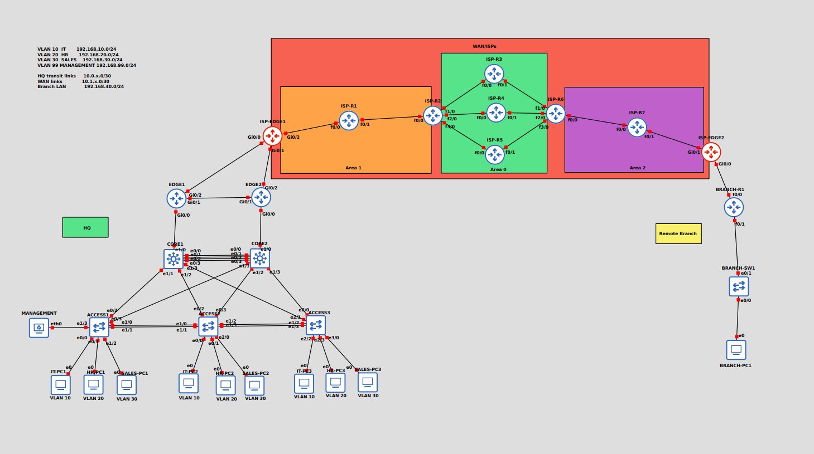

# Enterprise Campus & WAN Infrastructure Design & Implementation

A robust, enterprise-grade multi-site **Layer 2 and Layer 3 network architecture** built to simulate production environments, featuring high availability, dynamic routing (EIGRP & OSPF), site-to-site IPsec encryption, and comprehensive security hardening.

  

## 🧠 Lab Objectives

- Implement a **redundant core switching architecture** utilizing Layer 3 multi-layer switches.
    
      
    
- Establish **VLAN segmentation** for departmental isolation (IT, HR, Sales, Management).
    
      
    
- Deploy **HSRP Version 2** for sub-second default gateway redundancy and active-active load sharing.
    
      
    
- Optimize Layer 2 convergence using **Rapid PVST+ (802.1w)** and **LACP EtherChannel**.
    
      
    
- Configure dynamic routing across the campus core using **EIGRP AS 100** and across the ISP WAN core using **Multi-Area OSPF**.
    
      
    
- Secure access layer infrastructure using **Port Security**, **BPDU Guard**, **DHCP Snooping**, **Dynamic ARP Inspection (DAI)**, **Shutting Down Unused Ports**  and **DTP disabled**.
    
      
    
- Enforce edge security via **NAT/PAT overload** with VPN traffic exemption.
    
      
    
- Connect a remote branch office securely over the WAN using an **IKEv1 / IPsec Site-to-Site VPN Tunnel**.
    
      
    
- Ensure strict administrative security via **SSH v2** and strict password policies.
    
      
    

## 🧰 Technologies & Protocols Used

- **VLANs & Trunking**:
    
      
    - VLAN 10 - IT (`192.168.10.0/24`)
        
          
        
    - VLAN 20 - HR (`192.168.20.0/24`)
        
          
        
    - VLAN 30 - Sales (`192.168.30.0/24`)
        
          
        
    - VLAN 99 - Management (`192.168.99.0/24`)
        
          
        
    - 802.1Q trunking with Dynamic Trunking Protocol (**DTP disabled** via `switchport nonegotiate`).
        
          
        
- **Layer 2 Redundancy & Optimization**:
    
      
    - Rapid Per-VLAN Spanning Tree Plus (**Rapid PVST+**).
        
          
        
    - **LACP EtherChannel** (IEEE 802.3ad) bundling physical links between access and core switches.
        
          
        
- **Layer 3 Redundancy**:
    
      
    - Hot Standby Router Protocol Version 2 (**HSRPv2**) with active-active split priorities and preemption.
        
          
        
- **Dynamic Routing Protocols**:
    
      
    - **EIGRP AS 100** across HQ core-to-edge routed `/30` point-to-point transit links.
        
          
        
    - **OSPF Multi-Area** (Area 1, Area 0 Backbone, Area 2) across the ISP/WAN provider cloud.
        
          
        
- **Security & Hardening**:
    
      
    - **Port Security** (Max 2 MAC addresses, sticky learning, `shutdown` violation mode).
        
          
        
    - **Spanning Tree BPDU Guard** on all edge access ports.
        
          
        
    - **DHCP Snooping** & **Dynamic ARP Inspection (DAI)** with trusted uplinks.
        
          
        
    - **Unused port shutdown** across all switches.
        
          
        
    - **SSH v2** remote management encryption.
        
          
        
- **WAN & Perimeter Services**:
    
      
    - Split-scope centralized **DHCP** servers on core switches.
        
          
        
    - **NAT/PAT** overload with static route redistribution and VPN traffic exemption.
        
          
        
    - **IKEv1 IPsec Site-to-Site VPN** (AES-256, SHA-256, DH Group 14 / PFS).
        
          
        

## 🖥️ Topology Overview

  

- **Headquarters (HQ) Core & Access Layers**:
    
      
    - 2× Core Multi-layer switches (`CORE1`, `CORE2`) handling inter-VLAN routing, HSRP, and EIGRP.
        
          
        
    - 3× Access switches (`ACCESS1`, `ACCESS2`, `ACCESS3`) managing user ports, port security, and LACP uplinks.
        
          
        
- **HQ Edge & WAN Boundary**:
    
      
    - 2× Edge routers (`EDGE1`, `EDGE2`) and ISP aggregation router (`ISP-EDGE1`).
        
          
        
- **ISP Provider Cloud**:
    
      
    - A 7-router OSPF multi-area mesh (`ISP-R1` through `ISP-R7`) simulating carrier-grade transit.
        
          
        
- **Remote Branch Office**:
    
      
    - Gateway router (`BRANCH-R1`), access switch (`BRANCH-SW1`), and branch host (`BR-PC1` in `172.16.1.0/24`) connected securely via IPsec VPN.
        
          
        

## 📜 IP Addressing & HSRP Plan

|**VLAN**|**Purpose**|**CORE1 SVI IP**|**CORE2 SVI IP**|**HSRP Virtual IP (VIP)**|**Active Core**|
|---|---|---|---|---|---|
|**10**|IT|`192.168.10.2/24`|`192.168.10.3/24`|**`192.168.10.1/24`**|CORE1|
|**20**|HR|`192.168.20.2/24`|`192.168.20.3/24`|**`192.168.20.1/24`**|CORE1|
|**30**|Sales|`192.168.30.2/24`|`192.168.30.3/24`|**`192.168.30.1/24`**|CORE2|
|**99**|Management|`192.168.99.2/24`|`192.168.99.3/24`|**`192.168.99.1/24`**|CORE1|

**Transit & WAN Subnets Highlights:**

  

- HQ Core-to-Edge Links: `/30` point-to-point subnets (`10.0.1.0/30`, `10.0.2.0/30`).
    
      
    
- ISP OSPF Core: Multi-area `/30` links (`10.10.0.0/30` backbone, `10.10.1.0/30` Area 1, `10.10.2.0/30` Area 2).
    
      
    
- Remote Branch Transit: `10.10.3.0/30`.
    
      
    

## 🔒 Security & Hardening Implementation

- **Port Security**: Configured on access ports with sticky MAC learning (maximum 2 addresses) and `violation shutdown` to drop rogue devices and place ports into an `err-disabled` state.
    
      
    
- **BPDU Guard**: Globally enabled on all PortFast edge interfaces to instantly drop unauthorized BPDUs and prevent rogue switch insertion.
    
      
    
- **DTP Hardening**: Disabled Dynamic Trunking Protocol (`switchport nonegotiate`) on all static trunk links to eliminate protocol exploitation and overhead.
    
      
    
- **Unused Port Shutdown**: All inactive physical switch ports are administratively shut down.
    
      
    
- **DHCP Snooping & DAI**: Protects against rogue DHCP servers and MitM ARP spoofing attacks by validating frames against dynamic binding databases.
    
      
    
- **Management Security**: Telnet completely replaced with **SSH Version 2** using 2048-bit RSA keys and local privilege authentication.
    
      
    

## 🚀 Skills Demonstrated

* Enterprise campus network design, segmentation, and VLAN deployment.
* Layer 2 and Layer 3 **redundancy** and high availability using HSRPv2, LACP EtherChannel, and **STP / Rapid PVST+**.
* Dynamic interior gateway routing with EIGRP AS 100 (ECMP & passive interfaces).
* Large-scale OSPF multi-area WAN provider simulation and route redistribution.
* Traffic filtering and perimeter security using **Access Control Lists (ACLs)** and NAT/PAT overload with VPN traffic exemption.
* Cryptographic tunnel engineering via IKEv1 / IPsec Site-to-Site VPNs.
* Secure administrative remote access implementation using **SSH v2**.
* Production-level switch port hardening and threat mitigation (Port Security, BPDU Guard, DAI, DHCP Snooping, and **disabling unused ports**).
    
      
    

## 📂 Repository Contents

- `LAB_Documentation.md` - Full step-by-step technical deployment and configuration guide.
    
      
    
- `Network_Diagram.png` - High-resolution logical network topology diagram.
    
      
    

## 🔗 Connect
* [GitHub Profile](https://github.com/CyberSpherex)
* [LinkedIn](https://www.linkedin.com/in/mouad-am-it/)

  
  